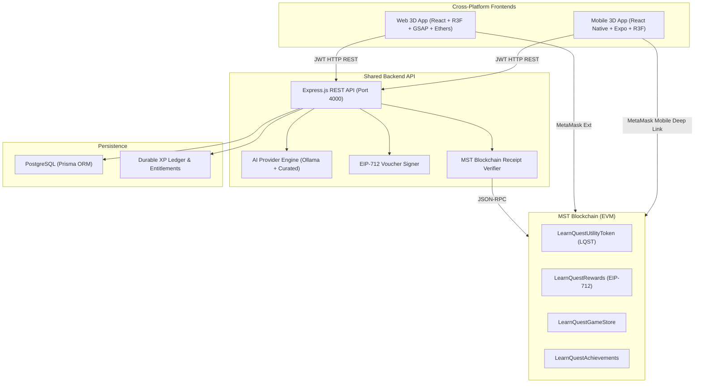
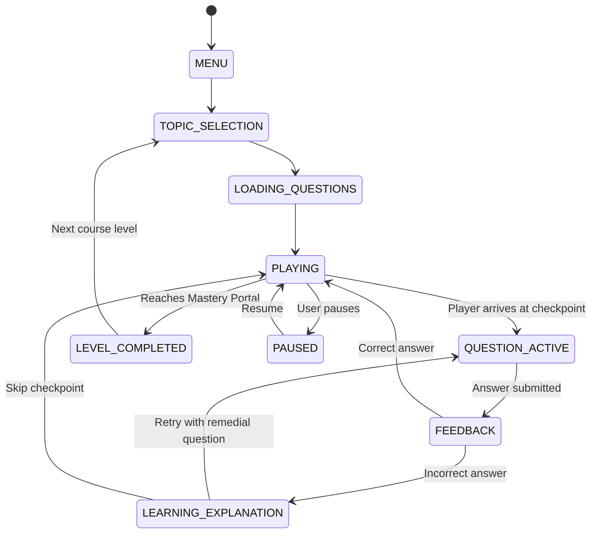

# LearnQuest Architecture Documentation

## 1. System Topology



---

## 2. Directory Structure

```
learnquest/
  apps/
    web/                  # React, Vite, Three.js, React Three Fiber, GSAP, Tailwind
    mobile/               # React Native, Expo, Three.js R3F, EAS APK/AAB config
    api/                  # Express.js REST API, Prisma, AI Service, Voucher Signer
  packages/
    shared/               # Network configs, game states, XP economy constants
    game-core/            # Pure game state machine, physics, course generator
    contracts-client/     # Contract ABIs, EIP-712 typed voucher utilities
    validation/           # Zod schemas for auth, AI outputs, learning sessions
  contracts/              # Hardhat, Solidity 0.8.24, OpenZeppelin 5.2, Tests
  prisma/
    schema.prisma         # Normalized database models & relationships
  docs/                   # Architecture, MST Blockchain, Ollama, EAS Build guides
  docker-compose.yml      # PostgreSQL and API container definitions
  .env.example            # Environment variables template
  package.json            # Monorepo npm workspaces definition
  README.md               # Main onboarding and project overview
```

---

## 3. Explicit Game State System



---

## 4. Economic Security & Reward Integrity

1. **Separation of Concerns:**
   - **Gameplay XP:** Purely internal learning progress metric, non-transferable, durable ledger with unique idempotency keys.
   - **Utility Token (`LQST`):** Standard ERC-20 token minted exclusively on MST Blockchain via signed EIP-712 vouchers.
2. **Server-Side Authority:**
   The frontend never dictates reward amounts or scores. All answer submissions and level completions are verified by the backend.
3. **Anti-Replay Nonces:**
   Every reward voucher includes a unique timestamped nonce stored in the contract mapping `isNonceUsed[user][nonce]`. Attempting to claim the same voucher twice reverts immediately on-chain.
4. **Independent Transaction Verification:**
   Store purchases and achievement credentials are never granted based solely on client claims. The backend calls `provider.getTransactionReceipt(hash)` directly against MST RPC nodes to confirm status `1` and destination contract address.
