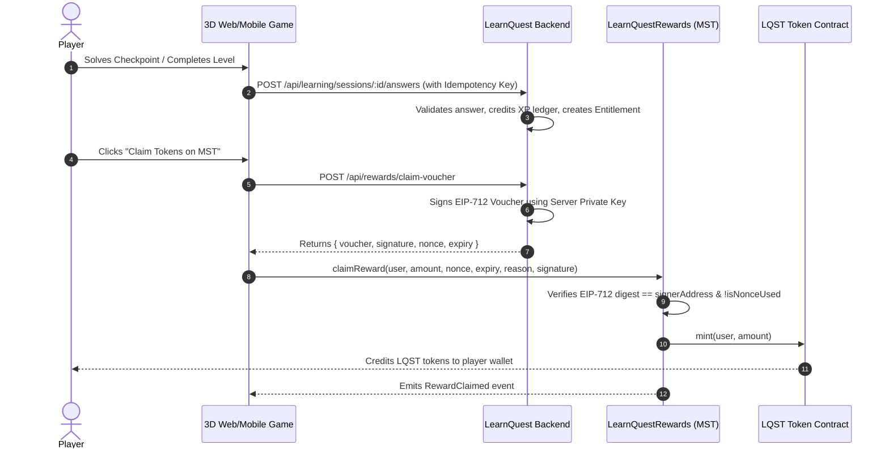

# MST Blockchain Integration Guide — LearnQuest

## Verified Network Parameters
All parameters verified on **2026-10-23** via [chainlist.org](https://chainlist.org) and [mstblockchain.com](https://mstblockchain.com).

### MST Testnet (Primary Target)
- **Network Name:** `MST Testnet`
- **Chain ID:** `91562037` (Configurable in `.env` via `MST_CHAIN_ID`, supports `4545` variant)
- **Chain ID Hex:** `0x5752035`
- **RPC URL:** `https://testnetrpc.mstblockchain.com`
- **WebSocket RPC:** `wss://testnetrpc.mstblockchain.com`
- **Currency Symbol:** `tMSTC`
- **Decimals:** `18`
- **Block Explorer:** [https://testnet.mstscan.com](https://testnet.mstscan.com)
- **Faucet:** Accessible via the developer portal at [https://mstblockchain.com](https://mstblockchain.com)

### MST Mainnet (Production Reference)
- **Network Name:** `MST Mainnet`
- **Chain ID:** `4646` (`0x1226`)
- **RPC URL:** `https://mariorpc.mstblockchain.com` or `https://craftrpc.mstblockchain.com`
- **Currency Symbol:** `MSTC`
- **Block Explorer:** [https://mstscan.com](https://mstscan.com)

---

## Deployed Smart Contracts

| Contract | Purpose | Standard / Pattern |
|---|---|---|
| **LearnQuestUtilityToken (`LQST`)** | In-game utility token | ERC-20, Capped Supply (100M), Role-based Minting |
| **LearnQuestRewards** | Claim reward tokens with EIP-712 signed vouchers | EIP-712, ECDSA, Anti-Replay Nonces, Expiry |
| **LearnQuestGameStore** | Purchase hint packs and cosmetics with LQST | SafeERC20, ReentrancyGuard, Price Validation |
| **LearnQuestAchievements** | Record course completions and credentials | Soulbound Educational Credential Registry |

---

## MetaMask Configuration

Users can automatically connect and add MST Testnet using the in-game **Connect** button or manually add:
- Network Name: `MST Testnet`
- New RPC URL: `https://testnetrpc.mstblockchain.com`
- Chain ID: `91562037`
- Currency Symbol: `tMSTC`
- Block Explorer URL: `https://testnet.mstscan.com`

---

## EIP-712 Cryptographic Reward Flow

